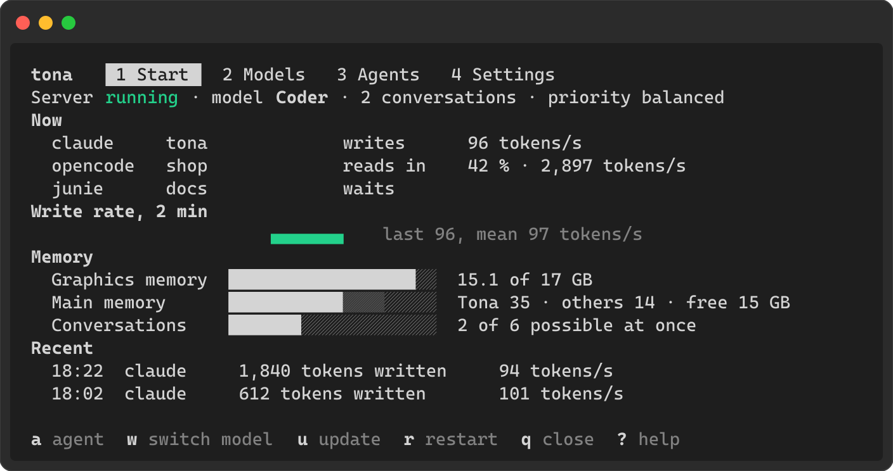
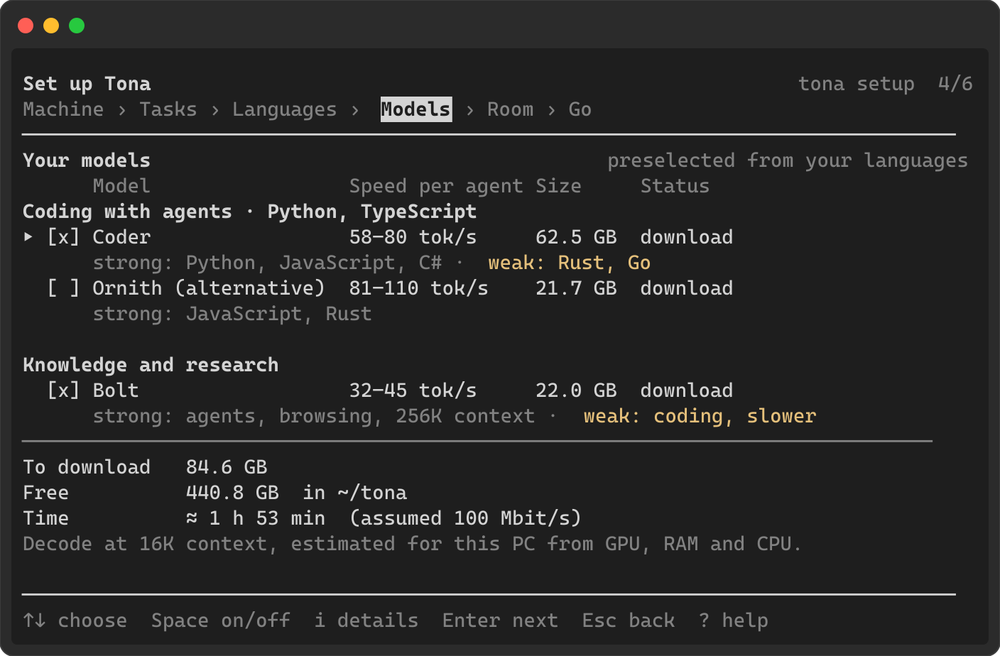

# Tona

Your local AI for any task.

No home PC runs one model that does everything. Pick a task — coding, research and knowledge, images (coming) — and Tona suggests models built for it and for your hardware. It spreads each model across VRAM, RAM and SSD, so large models run fast on a normal PC.



## Install

Linux (AMD Radeon RX 9060 XT, 64 GB RAM):

```sh
curl -fL -o tona https://github.com/tobias-nawa/tona/releases/latest/download/linux-x86_64-gfx1200-tona && chmod +x tona && ./tona
```

macOS (Apple silicon, macOS 15 or newer, experimental):

```sh
curl -fL -o tona https://github.com/tobias-nawa/tona/releases/latest/download/macos-arm64-tona && chmod +x tona && ./tona
```

`tona` asks what you want to do, recommends one model per task and downloads it. It checks the signature of the
release before it installs anything. Details: [docs/use/installer.md](docs/use/installer.md).



## Use

| Command | Does |
|---|---|
| `tona` | control centre; the guided setup when nothing is installed yet |
| `tona setup` | the guided setup again: models, tasks, room |
| `tona start` / `stop` / `restart` | server on, off, stop then start |
| `tona status`, `models`, `use`, `config`, `doctor` | server, model offer, switch model, settings, checks |
| `tona claude` / `opencode` / `junie` / `pi` | a coding agent against the local server, in this folder |
| `tona update` | check for a new release, install it, restart, roll back |
| `tona autostart on` / `off` / `status` | start the server at login |
| `tona uninstall` | remove Tona; the models stay unless you say so |
| `tona --version` | version, platform, backend |

Tona speaks the OpenAI and the Anthropic API on `http://127.0.0.1:8662`, so other tools work with it too.

## Models

| Model | For | Decode, 2K / 64K context |
|---|---|---|
| Coder (Qwen3.8-Flash-Next, IQ1_M) | coding with agents | 71 / 74 tok/s |
| Ornith 1.5 35B-A3B (Q4_K_M) | coding, Rust | 117 / 66 tok/s |
| Nemotron 3.5 Bolt 74B-A9B (2-bit) | knowledge and research | 41 / 37 tok/s |

Measured on the reference PC ([BENCHMARKS.md](BENCHMARKS.md)). Models come from Hugging Face and keep their own
licences. **Coming:** documents and images, speech to text, text to speech, image generation.

## Hardware

| Platform | Status |
|---|---|
| AMD RX 9060 XT (gfx1200), Linux | supported, the reference ([numbers](docs/backends/reference-platform.md)) |
| Apple silicon, macOS 15+ | experimental ([docs/use/macos.md](docs/use/macos.md)) |
| Other GPUs, CPU only, Windows | not yet |

Other hardware: tell your coding agent "optimize Tona for my hardware"
([docs/contribute/optimize-for-your-hardware.md](docs/contribute/optimize-for-your-hardware.md)).

## Documentation

- [How it works](docs/how-it-works.md) and [all features](docs/use/features.md)
- [The control centre](docs/use/client.md) and [settings](docs/use/environment.md)
- [Build from source](docs/contribute/development.md)
- [Contributing](CONTRIBUTING.md), [security](SECURITY.md)
- [Full index](docs/README.md)

Tona sends your prompts nowhere. It downloads the models you choose and, only if you switch it on, checks for updates
([docs/use/update.md](docs/use/update.md)).

## Support

One maintainer. A first reply to issues and pull requests within 14 days, to security reports within 7. Only the
latest release gets fixes.

## Licence

[MIT](LICENSE). Third-party code: [docs/contribute/licenses.md](docs/contribute/licenses.md).
